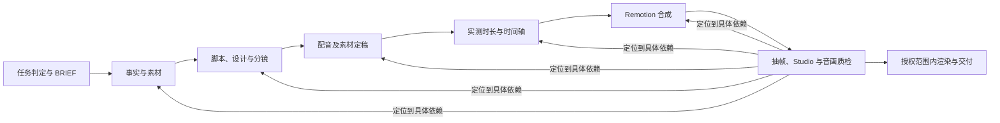

# Remotion 视频制作工作流

> 适用：从主题、资料或现有工程出发，制作、修改、预览或交付 Remotion 视频。研究取材、AI 配音和字幕按内容需要启用；纯动画、套件维护与单次导出走相应短路径。

## 1. 先判定任务形态

开始前读用户要求、项目现有文件与交付目标。已有项目以现有 `BRIEF.md`、源码和产物恢复上下文；一次具体修改无需重走创作访谈。

| 当前请求 | 进入点 | 完成范围 |
| --- | --- | --- |
| 新创作，只有主题或模糊想法 | `remotion-intent` → 确认 `BRIEF.md` | 按 brief 的交付范围进入下文主线 |
| 新创作，已有完整简报或脚本 | 核对缺失的关键约束 → `BRIEF.md` | 从素材、时间与设计规划开始 |
| 已有工程，要改场景、组件或主题 | 读项目、套件 `kit.md` 与变更影响 | 修改受影响文件并做针对性回归 |
| 只要 Studio 预览、抽帧、列合成或导出 | 直接执行对应操作 | 完成指定操作并核对产物 |
| 要建或改可复用套件 | `remotion-kits` | 套件、演示合成与按版式抽帧验证 |
| 只要方案或脚本 | 停在相应内容阶段 | 标明尚未合成、渲染的产物 |

**启动判据**：能说清视频的一句话核心信息、目标观众、目标画幅与时长范围、交付形式；已有项目则能说清本次修改对象和验收现象。尚不清楚的关键歧义才需要向用户确认。`BRIEF.md` 一旦确认，后续读取它，不重复提问。

新项目按 `remotion-intent` 的约定，先在合适的空目录建立最小脚手架，再把已确认的 brief 写到项目根；已有项目直接沿用或补写。下文“合成”阶段指实现视频内容，不把项目初始化推迟到那时。

## 2. 交付边界与文件归属

不要为每支片子机械创建全部文件。先按内容和交付需要选产物，再记录实际采用的路径。

| 产物 | 何时需要 | 持有什么信息 |
| --- | --- | --- |
| `BRIEF.md` | 新创作；已有项目若已有则沿用 | 用户意图、观众、信息、时长、画幅、风格、必须项与交付范围；**用户要求的事实来源** |
| `sources.md` + `facts.json` | 有外部事实、会变化的数据、引用或媒体素材 | 可打开的来源、核实时间、主张状态、素材许可与署名 |
| `script.md` | 有旁白、口播或复杂屏幕叙事 | 经确认的台词、屏幕文案与事实 ID |
| `design.md` | 需要明确视觉身份或跨场景一致性 | 字体、色彩、排版、安全区、动效与素材处理；已有品牌规范可直接作为依据 |
| `storyboard.json` 或 `STORYBOARD.md` | 多场景、需要分镜评审或由场景数据驱动 | 场景 ID、叙事作用、画面、文案、素材与预计时间；采用哪一种以项目契约为准 |
| `voice_manifest.json` + `public/audio/*` | 使用 TTS 或录音 | 文本版本、语音参数、文件、实测时长与试听结果 |
| `timeline.json` | 有多场景、配音、字幕或跨场转场 | 场景和媒体的绝对帧边界；**时间的单一来源** |
| `captions.json` / `.srt` | 需要字幕 | 校对后的字幕时间与文字 |
| Remotion 工程 | 要预览、修改或制作视频 | 可复现的合成源码、锁定依赖与本地素材 |
| `qa.md` | 制作或交付成片 | 检查结果、失败修复与未解决项 |
| `run_manifest.json` | 交付成片或要自动化重跑 | 输入版本、工具参数、各阶段状态、命令、输出及哈希 |
| `out/final.mp4` | 用户明确要求导出或交付成片 | 经核验的最终媒体 |

`BRIEF.md` 管“为何做、给谁看”；`sources.md` / `facts.json` 管“事实从哪来”；`script.md` 管“说什么”；`timeline.json` 管“何时发生”；源码管“如何呈现”；`run_manifest.json` 只记录这些文件的版本与执行事实，不再抄一份内容。场景之间用稳定的 `sceneId` 关联。

**范围解释**：明确要求“做成片/导出视频”即包含最终渲染；只要求构建合成、修改代码、预览或方案时，交付相应工程与预览证据。`remotion-create` 对渲染有明确门槛：用户明确要求渲染时才执行 `render`；单帧 `still` 可用于检查。若用户已授权成片交付，无需在每个检查点重复索取同一授权。

## 3. 一条主线，按依赖回退



配音、音乐、插图等在输入确定后可以并行准备；时间轴必须等最终音频和素材时长实测完成。每一阶段达到表中判据后再进入其下游。

| 阶段 | 执行动作 | 完成判据 |
| --- | --- | --- |
| 0. 意图与项目 | 判断新建/续作/单次操作；确认 brief；查现有工程与输出范围 | 关键约束与交付形式已明确，已有工作被复用 |
| 1. 事实与素材 | 需要研究时查原始或权威来源；收集可用素材和许可；冻结本地副本 | 每项确定语气的事实可追溯，待核实项未混入成稿 |
| 2. 叙事与设计 | 写脚本、分镜与设计规格；选已有套件或创建所需版式 | 场景顺序、信息层级、来源和画面意图均可定位 |
| 3. 音频与媒体 | 生成或导入旁白、音乐、音效、图像和视频；试听/检查 | 文件可打开，台词与音频版本一致，许可与参数已记录 |
| 4. 时间轴 | 测量实际时长；定停顿、转场、字幕和总帧数 | 帧区间合法，语音与字幕不截断，场景交接明确 |
| 5. 合成 | 装包、复制套件、实现组件与场景、注册 Composition | Studio 可打开，所有资源加载，指定帧可重现 |
| 6. 验证 | 跑静态检查、按版式抽帧、检查场界与音频、回退修正 | 检查记录可证伪且均通过；未通过项有明确状态 |
| 7. 交付 | 在已授权范围内渲染，检查文件并记录复现信息 | 最终媒体规格、时长、音轨、首尾内容正确且文件可播放 |

### 阶段 1：事实与素材

只有涉及外部事实时才启动联网取材；用户提供的原始材料也要区分“已给内容”和“经核实事实”。优先找一手来源，记录标题、URL、发布或更新日期、访问时间、对应主张及冲突。价格、版本、法规、人物职务等会变化的事实要核对时间。`facts.json` 每条至少含 `id`、`claim`、`sourceIds`、`checkedAt`、`status`（`verified` / `disputed` / `unverified`）。确定语气的旁白只引用 `verified`；争议内容要归属到说话方并在脚本中表达不确定性。

素材清单另记来源、许可、署名要求、下载或生成版本。进入合成前把实际使用的素材固定在项目中，避免渲染时依赖实时网页。完成判据是：逐条从脚本中的事实回溯到来源；逐个从画面素材回溯到文件和使用条件。

### 阶段 2：脚本、分镜与套件

先定叙事，再实现动效。每个场景写 `sceneId`、叙事作用、旁白或屏幕文案、视觉说明、素材 ID、事实 ID 和预计时长。开场要建立问题，主体按观众理解所需的顺序展开，结尾完成约定的信息或行动；不以“镜头数量”代替信息完整性。

按 `remotion-kits` 的 `references/catalog.md` 查已有套件。能覆盖的信息形态直接复用；确实缺版式、家具或主题时才扩展套件。使用套件的项目按工作区约定让场景调用版式、出片走 `MasterFrame`，并按版式抽帧。只有项目本身需要新视觉身份时才新增 `design.md`；已有品牌规范或套件主题直接沿用，并在 brief 中指向其依据。

### 阶段 3：音频与媒体

TTS 只在有旁白时运行。先固定脚本版本，再按场景或自然停顿分段生成；每段保存 `segmentId`、文本哈希、语言、提供方、模型、音色、语速、格式、文件路径、请求 ID、实测时长和试听结果。修改台词后只重做受影响段，并核对专名、数字、停顿和音质。音乐与音效在时间轴中显式安排；有人声时写明确的音量包络并试听，而非仅凭视觉波形判断混音。

TTS 服务用同一输入输出契约隔离：输入 `{segmentId, text, language, model, voice, speed, format}`，输出 `{file, durationMs, sampleRate, requestId}`。输出的 `durationMs` 仍要用生成后的音频文件复测；时间轴采用实测值。鉴权与服务专用参数留在适配器和安全配置中，清单只记可公开的模型参数与请求标识。

图片、视频、字体与图表数据也应保存确定的本地版本。异步加载资源在 Remotion 中按官方机制等待就绪；提交渲染前不能依赖未完成的下载、随机值或播放时钟。

### 阶段 4：时间轴与字幕

以最终音频、视频素材的**实测时长**为基础，再加入有意的停顿与转场。为避免多段音频各自 `ceil` 后累计漂移，先在毫秒时间线上确定每段的绝对起止，再换算为帧：

```ts
const startFrame = Math.round(startMs * fps / 1000);
const endFrame = Math.ceil(endMs * fps / 1000);
const durationInFrames = endFrame - startFrame;
```

`endMs` 包含该段实际音频与明确配置的尾部停顿；转场重叠要在总长计算中扣除。核对所有段 `startFrame >= 0`、`durationInFrames > 0`、末尾不早于最后一段音频结束，并明确记录有意的重叠和静默。字幕优先用语音对齐结果，再人工校对名称、数字、断句；字幕、旁白与场景应指向同一文本版本。静态可知的 `durationInFrames` 直接来自冻结的 `timeline.json`；确实取决于输入媒体时才用 `calculateMetadata()`，并只读取本地稳定输入。

### 阶段 5：Remotion 合成

先检查项目锁定的 Remotion 与全部 `@remotion/*` 版本是否一致，装新包用 `remotion add` 匹配项目版本。场景与合成采用固定输入，动画由帧号计算；CSS 自运行动画、随机值、实时网络数据和独立播放时钟不应决定最终帧。多场景可用 `<Sequence>`、`<Series>` 或 `<TransitionSeries>`；以实际时长与重叠量注册 `<Composition>`。字幕和语音按 `timeline.json` 放置，素材通过项目本地文件引用。

若要在 Studio 中直接编辑样式或关键帧，遵循 `remotion-interactivity` 的内联约定；这项能力取决于代码形状，不是所有合法 React 写法都会在 Studio 中可编辑。媒体、地图、3D、字幕、渲染等 API 由 `remotion-best-practices` 路由到对应领域技能；对版本敏感的 API 以项目安装版本和 `remotion-docs` 为准。

### 阶段 6：可证伪的验证

验证从最快的失败信号开始，然后检查画面与声音：

1. `compositions` 能列出目标合成；`tsc --noEmit` 通过；项目配置了 ESLint 时运行其规则；`remotion versions` 显示包版本一致。
2. 按**版式**抽代表帧，覆盖首帧、内容密集帧、末帧和场景交界；清单类版式额外看末尾。逐张看真实图像，检查安全区、溢出、字距、主题对比、素材与字幕。
3. 对随时间变化的功能抽两个会产生不同状态的帧，用画面或 DOM 差异验证“确实在动”；仅看到“播放中”状态或一张截图不足以证明动画有效。
4. 在 Studio 检查完整节奏与视觉连续性；试听旁白、音乐压混、静音、爆音、发音、首尾截断。必要时做短范围真实渲染验证只在导出期出现的问题。
5. 将检查项、帧号、结果和修复写入 `qa.md`。失败时回到最近的责任阶段，并重跑受影响的下游检查。

完成判据必须是可观察结果：例如“第 180 帧标题完整落在安全区内”“第 2、3 秒画面指纹不同”“最终音频尾部晚于最后一句结束”，而不是“看起来正常”。具体浏览器、抽帧与环境陷阱见 [README.md](README.md)「已知限制与未验证项」里的
「最容易再踩的坑」（PowerShell 与无头浏览器验收两类）。

### 阶段 7：渲染与交付

交付成片时记录实际的合成 ID、props 文件、渲染命令、Remotion 版本和输出路径。Windows 下向 CLI 传复杂 props 使用 JSON 文件。渲染完成后用媒体探测工具确认视频可播放、画幅、帧率、编解码器、声轨与实测时长；复查首尾画面和尾音。计算最终文件哈希，写入 `run_manifest.json`。若任务只要求方案、工程或预览，交付相应产物和未运行阶段的状态，不写成“成片已完成”。

## 4. 数据契约与变更传播

推荐使用一个任务目录，已有项目沿用其结构：

```text
video-job/
  BRIEF.md
  design.md                 # 需要新视觉规格时
  sources.md  facts.json    # 有事实研究时
  script.md                 # 有旁白或复杂叙事时
  storyboard.json           # 多场景时；也可按项目契约用 STORYBOARD.md
  voice_manifest.json      # 有配音时
  timeline.json             # 多场景/音频/字幕时
  captions.json             # 有字幕时
  qa.md  run_manifest.json  # 需要可追溯交付时
  public/audio/  public/assets/
  src/
  out/final.mp4             # 授权成片交付时
```

核心关联：`sceneId` 贯穿分镜、脚本、语音、时间轴、字幕与合成；`factId` 指向 `facts.json`；`sourceId` 指向 `sources.md`；`assetId` 指向实际本地文件和许可记录。`run_manifest.json` 记录文件哈希或版本、生成参数与阶段状态，不承担第二份脚本或时间轴。

最小时间轴例子（无旁白或字幕的场景省略对应 ID）：

```json
{
  "fps": 30,
  "compositionId": "MainVideo",
  "scenes": [
    {
      "sceneId": "scene-01",
      "startFrame": 0,
      "durationInFrames": 120,
      "voiceSegmentId": "voice-01",
      "captionIds": ["caption-01"],
      "sourceIds": ["source-01"]
    }
  ]
}
```

`run_manifest.json` 至少记录任务与合成 ID、输入文件哈希、Remotion 版本、素材和 TTS 参数（启用时）、阶段状态、实际运行的检查与渲染命令、输出文件哈希和媒体探测结果。未执行的阶段写 `not_requested` 或 `pending`，不可记成 `passed`。

| 变更 | 必须复查的下游 |
| --- | --- |
| 事实或来源修订 | 脚本中的对应主张 → 画面文案 → 配音/字幕 → 受影响场景 |
| 旁白文字修订 | 对应语音段 → 对齐时间 → 后续帧位 → 字幕 → 合成与抽帧 |
| 音频文件或语速修订 | 实测时长 → 时间轴 → 场景交接、字幕和总帧数 |
| 素材、字体或主题修订 | 使用它的版式与安全区 → 代表帧 → 受影响成片段 |
| 场景顺序或转场修订 | 绝对帧边界 → 音画重叠 → 总时长 → 首尾检查 |

冻结是为了保证一轮验证面对同一组输入，并非禁止修改。修改发生时更新受影响的产物与清单状态，避免“新脚本配旧音频”或“新时间轴配旧字幕”。

## 5. 本工作区运行方式

> ⚠️ **本节描述的是「本机工作区」，而它比本仓库大。** 仓库里只有 `remotion-kits-v2/`（套件与展示页）、
> `tools/`（维护工具）和根目录这两份 md。下面点到的 `remotion-kit-lab/`、`hotspot-zcode/`、`docs/`、
> `.shots/`、`hf-promo/` **都不在仓库里** —— 它们是判据与物证的产地，留在本机。所以那些相对路径在
> clone 出来的仓库里**不解析**：它们是**工作区坐标**，不是仓库内的链接。

在**工程根目录**执行 Remotion CLI；它从当前目录寻找入口。下面的命令是操作形状，具体合成 ID、文件名与项目脚本取当前工程实际值。`remotion-kit-lab` 当前锁定 `4.0.523`，新项目先查看自身 `package.json` 与 `remotion versions`，不要把这个版本当作永久常量。网络与浏览器等可变环境事实及复测命令见 [README.md](README.md)「安装与启动」与「自验」。

```powershell
$projectRoot = 'C:\path\to\video-job'
$compositionId = 'MainVideo'
Push-Location $projectRoot
& '.\node_modules\.bin\remotion.cmd' versions
& '.\node_modules\.bin\remotion.cmd' compositions
& '.\node_modules\.bin\tsc.cmd' --noEmit
& '.\node_modules\.bin\remotion.cmd' still $compositionId out\check.png --frame=30
& '.\node_modules\.bin\remotion.cmd' studio --no-open
# 仅在交付范围含成片/用户明确要求渲染时：
& '.\node_modules\.bin\remotion.cmd' render $compositionId out\final.mp4
& '.\node_modules\.bin\remotion.cmd' ffprobe out\final.mp4
Pop-Location
```

新建项目时，先按 `remotion-create` 选择脚手架与目录；既有工程优先复用依赖与配置。此机的 `remotion.config.ts` 要探测 Edge 并设置 `angle`，具体样例见 `remotion-kit-lab/remotion.config.ts`。`remotion` 抽帧与渲染会派生 esbuild 和 Edge；若受限环境报 `spawn EPERM`，在允许子进程的环境中重跑，不能把该错误归为合成代码缺陷。

脚手架示例：在适合创建新工程的父目录运行 `npx create-video@latest --yes --blank --no-tailwind video-job`，然后进入 `video-job`。先按 [README.md](README.md)「安装与启动」里的 `npm ping` 复测 npm 可达性。

> ⚠️ 原句还指到「[原技能体系文档](remotion-workflow.md) §2、§4」—— 那是**重写前**那份
> `docs/remotion-workflow.md`（**633 行 / 15 节**），本文取代了它，所以那个链接**指回了自己**。
> 那份旧文**不在本仓库里**（它只活在本机的历史快照归档里，而那种归档不进版本库）。
> 旧文 §13「实例对照：本工作区」在重写时被丢掉，**下面一节把它补回来了**。

### 实例对照：本工作区

本工作区里的套件有**四份**，判据是**逐字节一致**（`pwsh tools\mirror-check.ps1` 退出码 0）：

| 位置 | 是什么 |
| --- | --- |
| `~\.dsh\skills\remotion-kits\` | **技能母本** —— 改动的家 |
| `remotion-kits-v2/` | 母本的**镜像**（版本库里那一份） |
| `remotion-kit-lab/` | **验证测试台** —— 夹具与展示页在这里验 |
| `hotspot-zcode/production/` | **真实成片工程** —— 工作区里唯一走 Remotion 的片子 |

工程副本拿到的是**版本化源码快照**（不是技能安装）：`<工程>/src/kits/` 与母本逐字节一致，
更新走 [`remotion-kits-v2\tools\update-kits.ps1`](remotion-kits-v2/tools/update-kits.ps1)（**默认只报告**，`-Apply` 才写；
判据是 `<工程>\.kit-origin\` 里的基线）。⚠️ **更新器住在技能侧**（`remotion-kits-v2\tools\`），**不在**仓库根的
`tools\` —— 后者是工作区的维护工具，里面没有更新器。

> 工作区里还有一支 `hf-promo/`：**不是 Remotion** —— 它走 `npx hyperframes@0.8.47` 的
> `dev` / `check` / `render` / `publish`，另有自己的 `BRIEF.md` 与 `AGENTS.md`。
> 本节讲的是 Remotion 这条路，**不覆盖它**。

**每个工程自己的读数（合成条数、帧数、ffprobe 规格、抽帧抓到的缺陷）写在工程自己的文档里**，
不在本文复制 —— 复制过来就会漂。真片那次的交付与验收记录见 `hotspot-zcode/` 根下的
`OUTPUT.md` / `VERIFICATION.md`（工作区坐标，clone 后不解析）。

> **两条边界**：「元素能不能用、能怎么调」归套件展示页（输入是最坏情况夹具）；
> 「这一期的画面成不成立」归制作侧抽帧（输入是本期真实文案）。判据不在分工偏好，在数据上 ——
> 真实成片抽帧抓到的缺陷里，多数属于**内容层**，展示页**原理上**覆盖不到。


## 6. 按需查阅

| 遇到的问题 | 查阅处 |
| --- | --- |
| 从模糊想法确定体裁、brief 与执行模式 | 技能 `remotion-intent` 的 `SKILL.md` 与 `references/brief-format.md` |
| 复用、扩展或回归套件 | 技能 `remotion-kits` 的 `SKILL.md`、`references/catalog.md`、目标套件 `kit.md`；仓库里那一份在 [`remotion-kits-v2/`](remotion-kits-v2/) |
| 本机 Edge、字体、CLI、抽帧与验收判据 | [README.md](README.md)「安装与启动」·「自验」·「已知限制与未验证项」 |
| 当前 API 或升级 | `remotion-docs`、`remotion-upgrade` 与项目锁定版本的官方文档 |

以上文件是参考与契约，不替代用户当前任务要求。若规则冲突，先核对项目实际版本、当前用户要求和目标技能的适用范围，并在执行记录中说明采用的决定。
